# Насадки для Kenwood Cooking Chef XL KCL95.004SI: каталог для России

Актуализация: **4 октября 2026 года**. Подбор сделан для **KCL95.004SI**, с учётом уже имеющегося **Braun MultiQuick 9 MQ9147X**. Основные ссылки на товары ведут в российский магазин Kenwood; отдельные совместимые варианты без найденной российской карточки приведены по международной документации, их наличие в продаже в РФ не утверждается; техническая совместимость дополнительно сверена с документацией производителя. Цены и остатки магазинов здесь не фиксируются: столбец «В комплекте» означает именно штатную комплектацию машины.

В скобках после названия указаны прежние модели. **«Старые: —»** означает, что подтверждённый предшественник в использованных источниках не указан. Коды **AW… / KW…** могут обозначать товар или запчасть, а не отдельное старое поколение. «Аналог» в таблицах означает похожую функцию; существенные отличия указаны рядом.

## Приводы и штатная комплектация

| Обозначение | Где находится | Что подключается |
| --- | --- | --- |
| **ВС** | Высокоскоростной привод сверху | Комбайн, блендеры, AT320A, AT340, AT312, AT641 |
| **НС / Twist** | Низкоскоростной привод спереди | Мясорубка, барабанная тёрка, прессы, паста, зерновая мельница |
| **П** | Планетарное гнездо под головкой, над чашей | Венчик, крюк, K-насадка, гибкая и деликатная насадки; рабочие части сита и мороженицы |
| **М** | Отдельное гнездо мешалки рядом с планетарным | Мешалка для приготовления с нагревом KAT90.000ME |
| **Без привода** | Чаша или её край | Чаша, паровая корзина, вспомогательный зажим |

Расположение гнёзд и отдельное крепление мешалки показаны в [инструкции KCL95][manual95]. **Среднескоростного привода для старых AT640/AT647 у KCL95 нет.** [Пояснение Kenwood о типах приводов][medium].

В стандартном комплекте **KCL95.004SI** уже есть **K-насадка, венчик, крюк, насадка для мягких смесей, мешалка для приготовления и паровая корзина**, а также одна чаша 6,7 л. Внешние мясорубка, блендер, комбайн и насадки для пасты приобретаются отдельно. Подарки и расширенные наборы конкретного продавца могут добавляться сверх штатного комплекта. [Российская карточка KCL95.004SI][machine]. Зажим мешалки описан как элемент машины в [руководстве][manual95].

**Нельзя определять необходимость переходника по буквам AT.** Старые низкоскоростные насадки с соединением Bar требуют KAT002ME; верхние **AT320A, AT340, AT312, AT641** устанавливаются напрямую. Современные низкоскоростные модели KAX из таблиц ниже подходят к Twist-гнезду KCL95 напрямую. [Правила Kenwood по совместимости и адаптерам][compat-web].

## 1. Переходники

| Название и прежние модели | Назначение | Привод; совместимость с KCL95.004SI; подключение | В комплекте | Аналог / что не покупать вместе | Фото |
| --- | --- | --- | --- | --- | --- |
| **KAT002ME — переходник Bar → Twist** (старые: —) | Подключение старой низкоскоростной Bar-насадки к современной машине | **НС; да.** Сам адаптер ставится напрямую, старая насадка — через него | Нет | Вместо связки «старая AT + адаптер» можно купить соответствующую современную KAX. Для новой KAX не нужен | [Фото](images/KAT002ME.png) |
| **KAT001ME — переходник Twist → Bar** (старые: —) | Подключение новой Twist-насадки к старой машине с Bar-гнездом | **Для KCL95 не подходит и не нужен:** направление перехода обратное | Нет | Не является заменой KAT002ME; покупать к KCL95 не следует | [Фото](images/KAT001ME.png) |

Направления перехода и список старых насадок указаны в [таблице Kenwood][compat-old]. **Если покупаете всё с нуля, выбирайте актуальную KAX и подключайте напрямую; KAT002ME имеет смысл для уже имеющейся или выгодно купленной старой насадки.**

## 2. Комбайн, блендеры, овощерезки и соки — верхний привод

Совместимость этой группы с KCL95 подтверждена [официальным руководством по насадкам][compat-web]. Фотографии вынесены в галерею; из последнего столбца можно открыть отдельное изображение.

| Название и прежние модели | Что делает | Привод; совместимость с KCL95.004SI; подключение | В комплекте | Аналог / дублирование | Фото |
| --- | --- | --- | --- | --- | --- |
| **[KAH65.000PL — кухонный комбайн][kah65]** (KAH647PL; AT647/AT640 — более ранние, другой привод) | Нож, тёрки, шинковка, соломка; в актуальном комплекте **Express Dice для кубиков**. Рабочий объём 1,2 л | **ВС; да, напрямую.** KAH647PL также сверху напрямую; AT647/AT640 к этой машине не подходят | Нет | Тёрки пересекаются с AT340 и KAX643ME; кубики — с KAX400PL; нож — с измельчителями Braun. Покупать все сразу обычно не нужно | [Фото](images/KAH65.000PL.png) |
| **[AT320A — мини-измельчитель / мельничка][at320]** (AT320 — прежнее обозначение семейства) | Малые порции, сухой помол кофе и специй, орехи, соусы; стеклянные баночки | **ВС; да, напрямую**, несмотря на AT в названии | Нет | Braun 350 мл дублирует часть измельчения, но **не заменяет мельничку для кофейных зёрен и твёрдых специй**. Зерновую KAX941PL тоже не заменяет | [Фото](images/AT320A.png) |
| **[KAH359A.000GL — стеклянный блендер ThermoResist][blender]** (KAH359GL, KAH358GL) | Смузи, супы-пюре, соусы, лёд; до 1,6 л холодных / 1,2 л горячих смесей по карточке РФ | **ВС; да, напрямую** | Нет | Сильно пересекается с погружной ногой и кувшином Braun; также с KAH740PL. Доплата за стеклянный кувшин и формат стационарного блендера | [Фото](images/KAH359A.000GL.jpg) |
| **[KAH740PL — блендер для смузи Blend-Xtract Sport][kah740]** (старые: —) | Смузи непосредственно в бутылке, которую можно взять с собой | **ВС; да, напрямую** | Нет | KAH359A.000GL и Braun уже делают смузи; преимущество здесь — дорожная бутылка, а не новая функция | [Фото](images/KAH740PL.png) |
| **[AT340 — высокоскоростная овощерезка][at340]** (AT998A) | Тёрка и шинковка, 7 дисков, **непрерывная выгрузка** в отдельную посуду | **ВС; да, напрямую** | Нет | KAH65.000PL и KAX643ME. Выбирать AT340 для больших объёмов; универсального ножа и кубикорезки у неё нет | [Фото](images/AT340.png) |
| **[AT312 — цитрус-пресс][at312]** (AT312B — вариант обозначения той же серии) | Отжим цитрусовых половинками | **ВС; да, напрямую** | Нет | Ручной / отдельный электрический цитрус-пресс. С KAX720PL и AT641 есть пересечение по соку, но другое удобство подготовки | [Фото](images/AT312.png) |
| **[AT641 — центробежная соковыжималка][at641]** (AT641B — обозначение серии; AWAT641B01 — товарный код) | Быстрый отжим фруктов и овощей с отделением жмыха | **ВС; да, напрямую** | Нет | KAX720PL — основной аналог по конечной задаче. Для начала выбрать одну соковыжималку | [Фото](images/AT641.png) |

### Что важно при выборе KAH65.000PL

В российской карточке **KAH65.000PL прямо заявлены кубики Express Dice**, а приложенная инструкция содержит решётку и толкатель для кубиков. Поэтому прежнее утверждение «комбайн не режет кубики, обязательно докупите KAX400PL» для актуальной комплектации неверно. Перед заказом сверьте наличие решётки в конкретной коробке: в объявлениях могут использоваться старые фотографии. [Карточка РФ][kah65], [инструкция KAH65 с русским разделом][manual65].

Для кубиков используются **решётка и вращающийся регулируемый диск**. Продавливание брусочков через решётку выполняется вручную при выключенной машине. Инструкция не рекомендует для этой решётки сыр, ветчину и чоризо. **KAX400PL остаётся вариантом для непрерывной выгрузки кубиков**, если это отдельная частая задача; сначала оцените возможности уже купленного KAH65. [Инструкция KAH65][manual65], [карточка KAX400PL][kax400].

**KAH359A.000GL** выбран как актуальная карточка российского каталога; прежние KAH359GL/KAH358GL оставлены в скобках. Это не повод менять исправный блендер только ради нового кода. **AT640 не является старой соковыжималкой AT641** — это старый комбайн другого привода. [Актуальный блендер РФ][blender], [пояснение Kenwood об AT640/AT647][medium].

## 3. Мясо, овощи, прессы и зерно — передний привод

| Название и прежние модели | Что делает | Привод; совместимость с KCL95.004SI; подключение | В комплекте | Аналог / дублирование | Фото |
| --- | --- | --- | --- | --- | --- |
| **[KAX950ME — мясорубка][kax950]** (AT950 / AT950A / AT950B) | Фарш через решётку, колбасы и кеббе | **НС; да, напрямую.** Старые AT950 — через KAT002ME | Нет | Отдельная мясорубка. Нож Braun рубит мясо, но не даёт такой же фарш через решётку и не набивает колбасы | [Фото](images/KAX950ME.png) |
| **[KAX400PL — кубикорезка][kax400]** (MGX400) | Кубики 10 × 10 мм с непрерывной выгрузкой | **НС; да, напрямую.** Старый MGX400 — через KAT002ME согласно матрице | Нет | **KAH65.000PL с Express Dice**; ручная кубикорезка. После покупки актуального KAH65 приоритет снижается | [Фото](images/KAX400PL.png) |
| **[KAX643ME — барабанная тёрка / ломтерезка][kax643]** (AT643; AT642 — прежний комбинированный комплект) | Натирание и нарезка овощей, сыра, шоколада и других подходящих продуктов | **НС; да, напрямую.** Старые AT — через KAT002ME | Нет | AT340 / KAH65.000PL по тёрке и шинковке. Обычно достаточно одной системы | [Фото](images/KAX643ME.png) |
| **[KAX644ME — пресс для ягод и фруктов][kax644]** (AT644; AT642 — прежний комбинированный комплект) | Протирает мягкие фрукты, ягоды, томаты, отделяя семена и кожицу | **НС; да, напрямую.** Старые AT — через KAT002ME | Нет | KAT20.000GY для протирания; KAX720PL частично по соку. Braun измельчает, но не отделяет кожицу и семена | [Фото](images/KAX644ME.png) |
| **[KAX700PL — спиралайзер][kax700]** (старые: —) | Овощные спирали и «лапша» | **НС; да, напрямую** | Нет | Ручной спиралайзер. Соломка комбайна похожа по применению, но не даёт те же длинные спирали | [Фото](images/KAX700PL.png) |
| **[KAX720PL — шнековая соковыжималка][kax720]** (старые: —) | Медленный отжим с отделением жмыха | **НС; да, напрямую** | Нет | AT641 по получению сока; KAX644ME частично для ягод и томатов. Не покупать обе соковыжималки до выбора предпочтительного способа отжима | [Фото](images/KAX720PL.png) |
| **[KAX941PL — зерновая мельница][kax941]** (AT941 / AT941A) | Помол подходящего сухого зерна с настройкой крупности | **НС; да, напрямую.** Старые AT941 — через KAT002ME | Нет | Отдельная зерновая мельница. AT320A и измельчитель Braun не равноценны регулируемому зерновому помолу | [Фото](images/KAX941PL.png) |

Современное Twist-подключение подтверждено [матрицей Kenwood][compat-new]; старые Bar-модели и переход через KAT002ME — [таблицей старых насадок][compat-old]. **MGX400** — подтверждённая старая кубикорезка; модель «AT400» здесь не используется.

## 4. Раскатка, нарезка пасты и равиоли

| Название и прежние модели | Что делает | Привод; совместимость с KCL95.004SI; подключение | В комплекте | Аналог / дублирование | Фото |
| --- | --- | --- | --- | --- | --- |
| **[KAX99.A0ME — раскатка XL, 22 см][kax99]** (старые: —; KAX980ME — более узкая альтернатива) | Пласты для лазаньи, равиоли, пельменей; 10 настроек толщины | **НС; да, напрямую** | Нет | **KAX980ME**. Выбрать одну ширину, обе обычно не нужны | [Фото](images/KAX99.A0ME.png) |
| **[KAX980ME — раскатка, 15 см][kax980]** (KAX970ME; AT970 / AT970A) | Аналогичная раскатка более узкого пласта; 10 настроек толщины | **НС; да, напрямую.** KAX970 — напрямую; AT970 — через KAT002ME | Нет | KAX99.A0ME. **KAX980ME остаётся актуальной моделью**, а не обязательной к замене старой насадкой | [Фото](images/KAX980ME.png) |
| **[KAX981ME — резка Fettuccine][kax981]** (KAX971ME; AT971 / AT971A — прежняя Tagliatelle) | Ленты около 6,5 мм; нужен заранее раскатанный пласт | **НС; да, напрямую.** Старые KAX — напрямую; AT — через KAT002ME | Нет | Другие паста-резки меняют ширину; вручную ножом можно нарезать похожие ленты. Для начала достаточно одной резки | [Фото](images/KAX981ME.png) |
| **[KAX982ME — резка Tagliolini][kax982]** (KAX972ME; AT972 / AT972A) | Тонкие ленты около 1,5 мм | **НС; да, напрямую.** Старые KAX — напрямую; AT — через KAT002ME | Нет | KAX984ME частично для тонкой длинной пасты; различаются сечение и ширина | [Фото](images/KAX982ME.png) |
| **[KAX983ME — резка Trenette][kax983]** (KAX973ME; AT973 / AT973A) | Ленты около 3,5 мм | **НС; да, напрямую.** Старые KAX — напрямую; AT — через KAT002ME | Нет | KAX981ME и ручная нарезка: похожее применение, другая ширина | [Фото](images/KAX983ME.png) |
| **[KAX984ME — резка Spaghetti][kax984]** (KAX974ME; AT974 / AT974A) | Спагетти около 2 мм из раскатанного пласта | **НС; да, напрямую.** Старые KAX — напрямую; AT — через KAT002ME | Нет | KAX982ME; пресс с матрицей длинной пасты — другой способ приготовления | [Фото](images/KAX984ME.png) |
| **[KAX93.A0ME — равиоли][kax93]** (старые: —) | Формует равиоли из подготовленного пласта и начинки | **Да; крепление в НС напрямую, вращение вручную рукояткой**, мотор не приводит её в движение | Нет | Ручные формы, штампы, нож для равиоли. Раскатка нужна отдельно; широкий пласт XL подрезают под валики | [Фото](images/KAX93.A0ME.png) |
| **[KAX92.A0ME — пресс для фигурной пасты][kax92]** (KAX910ME; AT910) | Выдавливает пасту через сменные матрицы; раскатка не требуется | **НС; да, напрямую.** KAX910 — напрямую; AT910 — через KAT002ME | Нет | Раскатка + резка дают длинную пасту, но не заменяют пресс для полых и фигурных форм | [Фото](images/KAX92.A0ME.png) |
| **[MAX980ME — набор для пасты][max980]** (старые: —; комплект, а не отдельная насадка) | **KAX980ME + KAX981ME + KAX984ME** | **НС; все три совместимы, напрямую**, по очереди | Нет | Дублирует покупку этих трёх по отдельности. После покупки набора не докупать такую же раскатку и резки | [Фото](images/MAX980ME.jpg) |
| **[MAX94.A0ME — набор для равиоли][max94]** (старые: —; комплект) | **KAX980ME + KAX93.A0ME** | **Совместим:** раскатка — НС напрямую; равиоли — прямое крепление и ручная работа | Нет | Отдельные KAX980ME и KAX93.A0ME. Вместе с MAX980ME получите второй KAX980ME | [Фото](images/MAX94.A0ME.jpg) |

**KAX99.A0ME и KAX980ME — выбор ширины**, а не правило «старое обязательно заменить новым». При покупке в России встречается написание **KAX99AOME / KAX99A0ME XL**; ориентир для точной идентификации — **KAX99.A0ME, артикул AW20011038**. [Раскатка XL в РФ][kax99], [раскатка 15 см в РФ][kax980].

Паста-резки не раскатывают тесто; нужен роллер или ручная раскатка. Старые AT971 и нынешняя KAX981 не следует считать абсолютно одинаковыми по ширине только потому, что они относятся к одной линии резок. Ручной принцип KAX93 и подготовка пластов описаны в [инструкции равиоли][manual93]. Старые и современные крепления — в [таблице совместимости][compat-old].

### Матрицы для KAX92.A0ME — выбирать формы, а не покупать всё

Все позиции ниже **совместимы с KCL95 через установленный KAX92.A0ME**: привод **НС**, пресс подключён **напрямую**, матрица вкручивается в пресс; **KAT002ME не нужен**. Сама матрица к гнезду машины не подключается. **В комплект KCL95.004SI ни одна из них не входит.** Коды AWAT910… в скобках — товарные обозначения тех же изделий, а не новые/старые моторные насадки. [Система матриц Kenwood][dies], [совместимость пресса][compat-web].

| Название и товарное обозначение | Форма / назначение | Подключение и комплект KCL95.004SI | Аналог / что дублируется | Фото |
| --- | --- | --- | --- | --- |
| **[A910/1 — Bigoli][die1]** (AWAT910002; отдельный старый аналог не указан) | Толстая длинная паста | НС через KAX92 напрямую; в машине нет | Другие матрицы длинной пасты; выбрать любимую форму | [Фото](images/A910-1.jpg) |
| **[A910/2 — Casarecce][die2]** (AWAT910003; отдельный старый аналог не указан) | Скрученная короткая паста | НС через KAX92 напрямую; в машине нет | Другие короткие формы A910; та же базовая задача | [Фото](images/A910-2.jpg) |
| **[A910/3 — Maccheroni Lisci][die3]** (AWAT910004; отдельный старый аналог не указан) | Гладкие трубочки | НС через KAX92 напрямую; в машине нет | Матрица рифлёных Maccheroni Rigati, если она есть в комплекте вашего пресса | [Фото](images/A910-3.jpg) |
| **[A910/4 — Spaccatelli][die4]** (AWAT910005; отдельный старый аналог не указан) | Короткая паста с продольным раскрытием | НС через KAX92 напрямую; в машине нет | Casarecce и другие короткие формы по применению в блюдах | [Фото](images/A910-4.jpg) |
| **[A910/5 — Spaghetti Quadri][die5]** (AWAT910006; отдельный старый аналог не указан) | Длинная паста квадратного сечения | НС через KAX92 напрямую; в машине нет | KAX984ME даёт спагетти другим способом; выбрать пресс или раскатку с резкой | [Фото](images/A910-5.jpg) |
| **[A910/6 — Pappardelle][die6]** (AWAT910007; отдельный старый аналог не указан) | Широкие ленты | НС через KAX92 напрямую; в машине нет | Раскатка + ручная нарезка широких лент | [Фото](images/A910-6.jpg) |
| **[A910/7 — Sfilatelli][die7]** (AWAT910008; отдельный старый аналог не указан) | Паста формы Sfilatelli; в каталоге РФ встречается «силателле» | НС через KAX92 напрямую; в машине нет | Другие матрицы пресса: меняется форма результата | [Фото](images/A910-7.jpg) |
| **[A910/8 — Linguine][die8]** (AWAT910009; отдельный старый аналог не указан) | Плоская длинная паста | НС через KAX92 напрямую; в машине нет | KAX981/982/983 по длинной ленточной пасте, но иные ширина и способ | [Фото](images/A910-8.jpg) |
| **[A910/9 — Fusilli][die9]** (AWAT910010; отдельный старый аналог не указан) | Спиральная паста | НС через KAX92 напрямую; в машине нет | Другие короткие формы; паста-резки спираль не заменяют | [Фото](images/A910-9.jpg) |
| **[A910/10 — Conchigliette][die10]** (AWAT910011; отдельный старый аналог не указан) | Маленькие ракушки | НС через KAX92 напрямую; в машине нет | A910/12 по чашеобразной короткой пасте; геометрия отличается | [Фото](images/A910-10.jpg) |
| **[A910/11 — Bucatini][die11]** (AWAT910012; отдельный старый аналог не указан) | Длинная паста с отверстием | НС через KAX92 напрямую; в машине нет | Спагетти по применению, но полость обычная резка не делает | [Фото](images/A910-11.jpg) |
| **[A910/12 — Orecchiette][die12]** (AWAT910013; отдельный старый аналог не указан) | «Ушки» | НС через KAX92 напрямую; в машине нет | A910/10 по задаче короткой пасты; ручная формовка ушек | [Фото](images/A910-12.jpg) |
| **[A910/13 — формовка печенья][die13]** (AWAT910014 / AT910014; тот же аксессуар) | Выдавливает тесто для печенья; не матрица обычной пасты | НС через KAX92 напрямую; в машине нет | Кондитерский мешок, ручной пресс для печенья | [Фото](images/A910-13.jpg) |

**Сначала купите пресс и проверьте его комплектную матрицу**, затем докупайте одну-две действительно нужные формы. Покупка KAX92 не означает, что все A910/1–12 входят в коробку. Наименование штатной матрицы сверяйте с конкретным набором продавца. Соответствие A910-кодов товарным артикулам приведено в [каталоге Kenwood][dies-catalog].

Набор **MAX94.A0ME** приведён для сравнения состава: активная карточка в российском каталоге не найдена. В РФ можно подобрать отдельные KAX980ME и KAX93.A0ME.

## 5. Насадки чаши: что уже есть, а что добавляет функцию

Для строк «Да, по типу» наличие относится к штатному инструменту соответствующего назначения. Отдельно продаваемый артикул замены может отличаться от маркировки детали в коробке. [Комплектация машины в РФ][machine], [совместимость инструментов чаши][compat-new].

| Название и прежние модели | Что делает | Привод; совместимость с KCL95.004SI; подключение | В комплекте | Аналог / дублирование | Фото |
| --- | --- | --- | --- | --- | --- |
| **[KAT70.000SS — K-насадка XL из нержавеющей стали][kat70]** (KW711977 — совместимый код запчасти, не старое поколение) | Плотные смеси, песочное тесто, общие задачи смешивания | **П; да, напрямую** | **Да, K-насадка по типу** | Штатная K-насадка уже есть. Покупать как замену или второй инструмент | [Фото](images/KAT70.000SS.png) |
| **[KAT70.000CA — алюминиевая K-насадка XL][kat70ca]** (старые: —; AS00000235 — код детали) | Те же базовые задачи K-насадки | **П; да, напрямую** | **Нет именно этой версии:** есть штатная стальная K-насадка | KAT70.000SS / штатная K-насадка; функциональное дублирование | [Фото](images/KAT70.000CA.png) |
| **[KAT71.000SS — венчик XL][kat71]** (KW717138 — совместимый код запчасти) | Белки, сливки, воздушные смеси | **П; да, напрямую** | **Да, венчик по типу** | Уже есть штатный венчик; Braun также взбивает небольшие порции | [Фото](images/KAT71.000SS.png) |
| **[KAT72.000SS — спиральный крюк XL][kat72]** (KW716555 — совместимый код запчасти) | Замес теста | **П; да, напрямую** | **Да, крюк по типу** | Штатный крюк. Второй ради расширения функций не нужен | [Фото](images/KAT72.000SS.png) |
| **[KAT73.000CA — алюминиевый крюк XL][kat73]** (старые: —) | Замес теста | **П; да, напрямую** | **Нет этой версии:** есть штатный стальной крюк | KAT72.000SS / штатный крюк | [Фото](images/KAT73.000CA.png) |
| **[AT502 — гибкая насадка XL][at502]** (старые: —; AT501 — меньший размер, не подходящая замена) | Мягкие смеси, кремы, снятие смеси со стенок | **П; да, напрямую** | **Да по назначению:** насадка для мягких смесей уже есть; её продажный код в карточке машины не указан | Штатная высокотемпературная гибкая насадка. Не первая покупка | [Фото](images/AT502.png) |
| **[AT512 — насадка для деликатного смешивания XL][at512]** (AT512MAJOR — обозначение того же размера; AT511CHEF — меньшая версия) | Вмешивание ингредиентов в воздушные смеси | **П; да, напрямую** | Нет | Ручная лопатка. Не равноценна венчику или обычному интенсивному смешиванию | [Фото](images/AT512.png) |
| **[KAT90.000ME — мешалка Cooking Chef][kat90]** (KW713836 — старая мешалка KM08, **не подходит KCL95**) | Перемешивание при приготовлении и нагреве | **М; да, напрямую в отдельное гнездо мешалки** | **Да, мешалка по типу** | Штатная мешалка. K-насадка не полностью заменяет её для приготовлений с нагревом | [Фото](images/KAT90.000ME.png) |
| **[KAT20.000GY — сито / протирка][kat20]** (AT930 — совместимая старая XL; AT992 — другой размер) | Протирание, отделение кожицы и семян, просеивание | **П + чаша; да, лопасть напрямую** с комплектным валом XL; сито — в чашу. **Без KAT002ME** | Нет | KAX644ME для ягод/томатов; ручное сито. Braun не отделяет семена | [Фото](images/KAT20.000GY.png) |
| **[KAX71.000WH — мороженица][kax71]** (AT957A — совместимая старая версия; AT956A/KAB956PL/KAB957PL не брать для KCL95) | Перемешивание и замораживание десерта в предварительно охлаждённой ёмкости | **П; да.** Лопасть — к приводу; морозильная ёмкость — **через комплектное адаптерное кольцо** в основную чашу. **KAT002ME не нужен** | Нет | Отдельная мороженица. Braun лишь измельчает уже замороженные продукты | [Фото](images/KAX71.000WH.png) |
| **[KAB90.000SS — индукционная чаша 6,7 л][kab90]** (KAT911SS — совместимая более ранняя чаша) | Основная или вторая рабочая чаша Cooking Chef | **Без привода; да**, на штатное место чаши, без переходника | **Одна чаша есть; второй нет** | Штатная чаша. Вторую покупать для удобства смены блюд; обычная чаша Chef XL того же объёма не является автоматической заменой | [Фото](images/KAB90.000SS.png) |
| **[KAT91.000CL — паровая корзина][kat91]** (старые: —) | Приготовление на пару над водой в чаше | **Без привода; да**, внутри чаши, без переходника | **Да, паровая корзина** | Штатная корзина / отдельная пароварка. CAM01.A0SS для CookEasy+ сюда не подходит | [Фото](images/KAT91.000CL.png) |
| **[KAT92.000BK — вспомогательный зажим мешалки][kat92]** (старые: —) | Помогает перемешиванию с Cooking Chef Stir Tool | **Без самостоятельного привода; да**, на край чаши, без переходника | **Да, зажим указан в руководстве** | Штатный зажим; самостоятельную насадку или мешалку не заменяет | [Фото](images/KAT92.000BK.png) |

**Мороженица не охлаждает сама:** ёмкость заранее замораживают на 24–48 часов, нагрев машины не используют. Для KCL95 по инструкции нужен **чёрный уплотнитель A** комплектного адаптерного кольца; серый B предназначен для других перечисленных моделей. Это кольцо устанавливается на чашу и не связано с низкоскоростным **KAT002ME**. [Инструкция KAX71 на сайте РФ][manual71].

**KAT20.000GY поставляется с двумя валами:** для вашей машины используют вал **Chef XL**, затем регулируют высоту лопасти. Отдельный переходник не покупают. Перед установкой сита или мороженицы снимают предусмотренные инструкциями теплозащитный и брызгозащитный блоки. [Инструкция KAT20][manual20], [инструкция KAX71][manual71].

**KAT92 используют с мешалкой для приготовления; при K-насадке, венчике, крюке и гибкой насадке зажим снимают.** Это реальный конфликт установки внутри Kenwood. [Инструкция KCL95][manual95].

### Несовместимые варианты, которые встречаются при поиске

| Модель | Почему не брать к KCL95.004SI | Подходящий вариант |
| --- | --- | --- |
| **AT640 / AT647** | Требуют отсутствующий среднескоростной привод; KAT002ME это не исправляет | KAH65.000PL или старый KAH647PL |
| **AT501 / AT511 / AT992** | Инструменты/сито для меньшей чаши, не соответствующая XL-версия | AT502 / AT512 / KAT20.000GY |
| **AT956A / KAB956PL / KAB957PL** | В матрице нет совместимости этих морожениц с KCL95 | KAX71.000WH; из старых — подтверждённая AT957A |
| **KW713836** | Мешалка прежнего Cooking Chef KM08, другое поколение | KAT90.000ME |
| **KAG30.000GY / KAG50.000GY** | Насадки для **Kenwood Go KZM35**, не для Cooking Chef XL | AT320A / KAH740PL соответственно |
| **CAM01.A0SS** | Пароварка для **CookEasy+ CCL50**, несмотря на присутствие в общем российском каталоге | Штатная корзина / KAT91.000CL |
| **KAT001ME** | Обратное направление перехода, для старых машин Bar | KAT002ME — только для конкретной старой Bar-насадки |

Основания: [матрица Kenwood][compat-new], [пояснение о старых комбайнах][medium], [совместимость аксессуаров Go][go], [карточка пароварки CookEasy+][cam01].

## 6. Фотогалерея

Реальные фотографии из карточек Kenwood/Braun и [официальной таблицы совместимости][compat-new]. Изображения сохранены рядом с документом в папке **images**; при переносе Markdown переносите и эту папку. Подпись ведёт к изображению полного размера. Фотографии показывают внешний вид, а состав конкретного набора указан в таблицах выше.

### 1. Переходники

| Фото | Фото | Фото |
| --- | --- | --- |
| [KAT002ME](images/KAT002ME.png) [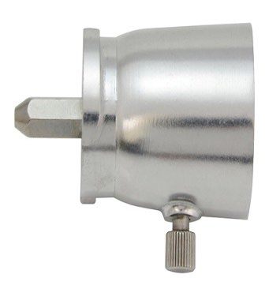](images/KAT002ME.png) | [KAT001ME](images/KAT001ME.png) [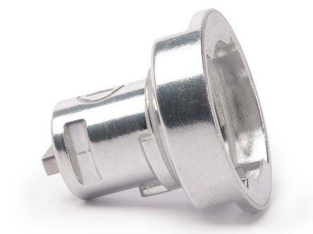](images/KAT001ME.png) |  |

### 2. Комбайн, блендеры, овощерезки и соки — верхний привод

| Фото | Фото | Фото |
| --- | --- | --- |
| [KAH65.000PL](images/KAH65.000PL.png) [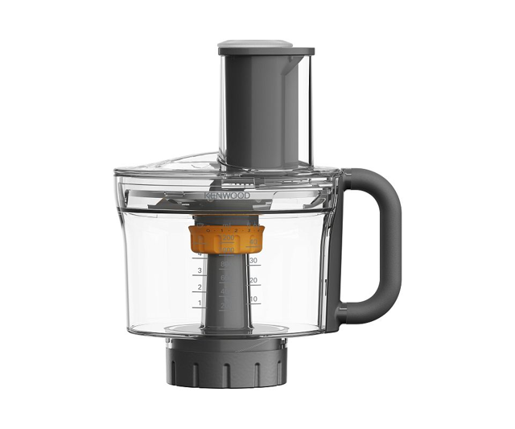](images/KAH65.000PL.png) | [AT320A](images/AT320A.png) [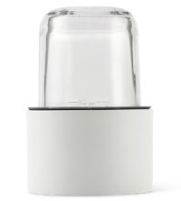](images/AT320A.png) | [KAH359A.000GL](images/KAH359A.000GL.jpg) [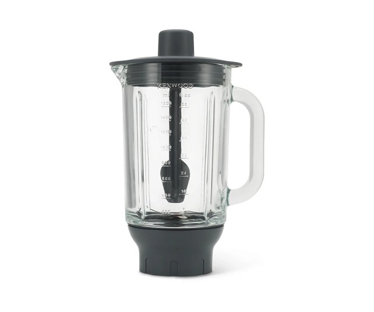](images/KAH359A.000GL.jpg) |
| [KAH740PL](images/KAH740PL.png) [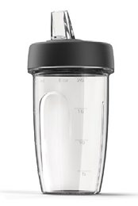](images/KAH740PL.png) | [AT340](images/AT340.png) [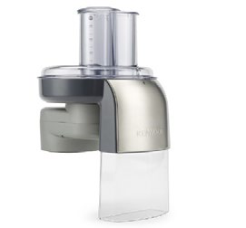](images/AT340.png) | [AT312](images/AT312.png) [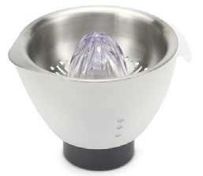](images/AT312.png) |
| [AT641](images/AT641.png) [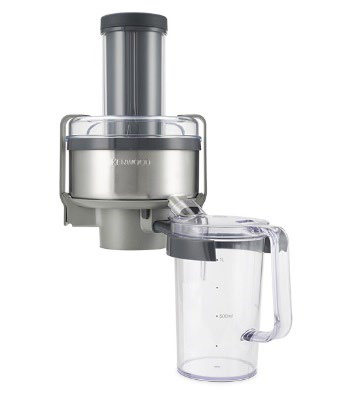](images/AT641.png) |  |  |

### 3. Мясо, овощи, прессы и зерно — передний привод

| Фото | Фото | Фото |
| --- | --- | --- |
| [KAX950ME](images/KAX950ME.png) [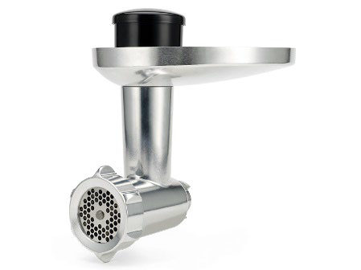](images/KAX950ME.png) | [KAX400PL](images/KAX400PL.png) [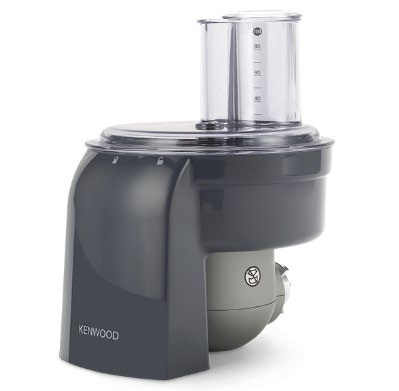](images/KAX400PL.png) | [KAX643ME](images/KAX643ME.png) [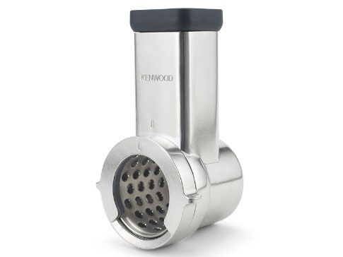](images/KAX643ME.png) |
| [KAX644ME](images/KAX644ME.png) [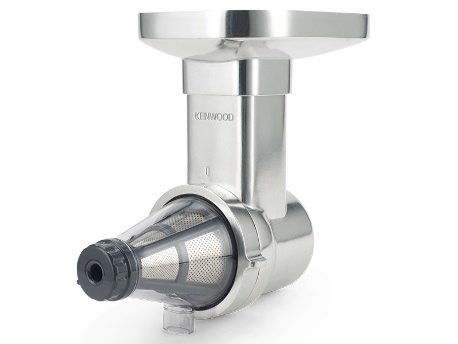](images/KAX644ME.png) | [KAX700PL](images/KAX700PL.png) [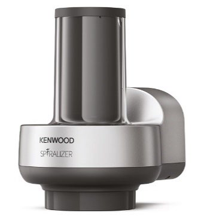](images/KAX700PL.png) | [KAX720PL](images/KAX720PL.png) [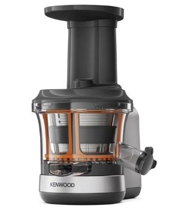](images/KAX720PL.png) |
| [KAX941PL](images/KAX941PL.png) [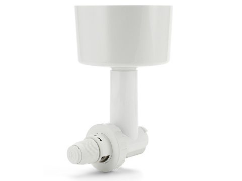](images/KAX941PL.png) |  |  |

### 4. Раскатка, нарезка пасты и равиоли

| Фото | Фото | Фото |
| --- | --- | --- |
| [KAX99.A0ME](images/KAX99.A0ME.png) [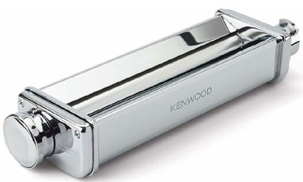](images/KAX99.A0ME.png) | [KAX980ME](images/KAX980ME.png) [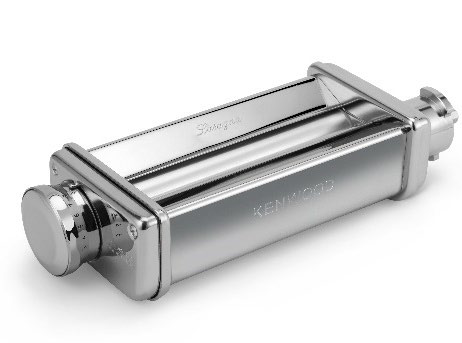](images/KAX980ME.png) | [KAX981ME](images/KAX981ME.png) [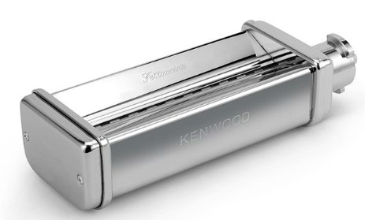](images/KAX981ME.png) |
| [KAX982ME](images/KAX982ME.png) [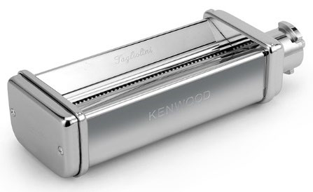](images/KAX982ME.png) | [KAX983ME](images/KAX983ME.png) [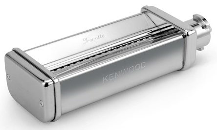](images/KAX983ME.png) | [KAX984ME](images/KAX984ME.png) [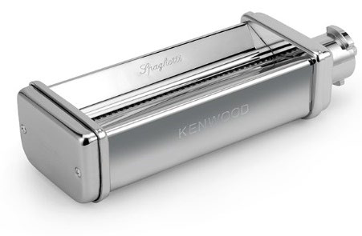](images/KAX984ME.png) |
| [KAX93.A0ME](images/KAX93.A0ME.png) [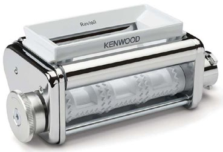](images/KAX93.A0ME.png) | [KAX92.A0ME](images/KAX92.A0ME.png) [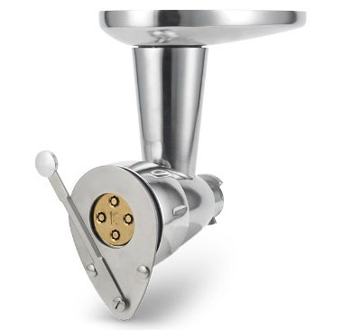](images/KAX92.A0ME.png) | [MAX980ME](images/MAX980ME.jpg) [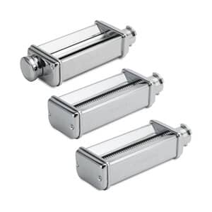](images/MAX980ME.jpg) |
| [MAX94.A0ME](images/MAX94.A0ME.jpg) [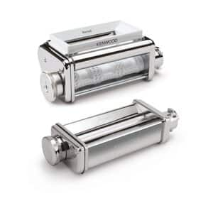](images/MAX94.A0ME.jpg) | [A910/1](images/A910-1.jpg) [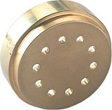](images/A910-1.jpg) | [A910/2](images/A910-2.jpg) [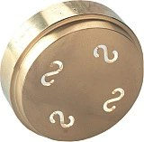](images/A910-2.jpg) |
| [A910/3](images/A910-3.jpg) [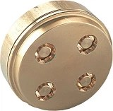](images/A910-3.jpg) | [A910/4](images/A910-4.jpg) [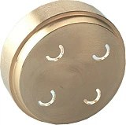](images/A910-4.jpg) | [A910/5](images/A910-5.jpg) [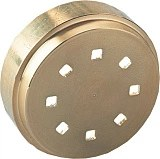](images/A910-5.jpg) |
| [A910/6](images/A910-6.jpg) [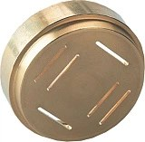](images/A910-6.jpg) | [A910/7](images/A910-7.jpg) [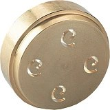](images/A910-7.jpg) | [A910/8](images/A910-8.jpg) [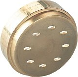](images/A910-8.jpg) |
| [A910/9](images/A910-9.jpg) [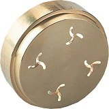](images/A910-9.jpg) | [A910/10](images/A910-10.jpg) [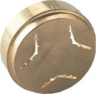](images/A910-10.jpg) | [A910/11](images/A910-11.jpg) [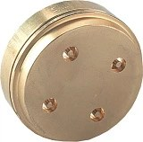](images/A910-11.jpg) |
| [A910/12](images/A910-12.jpg) [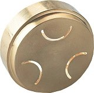](images/A910-12.jpg) | [A910/13](images/A910-13.jpg) [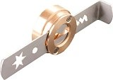](images/A910-13.jpg) |  |

#Набор **MAX94.A0ME** приведён для сравнения состава: активная карточка в российском каталоге не найдена. В РФ можно подобрать отдельные KAX980ME и KAX93.A0ME.

## 5. Насадки чаши: что уже есть, а что добавляет функцию

| Фото | Фото | Фото |
| --- | --- | --- |
| [KAT70.000SS](images/KAT70.000SS.png) [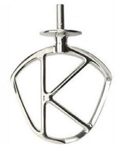](images/KAT70.000SS.png) | [KAT70.000CA](images/KAT70.000CA.png) [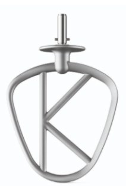](images/KAT70.000CA.png) | [KAT71.000SS](images/KAT71.000SS.png) [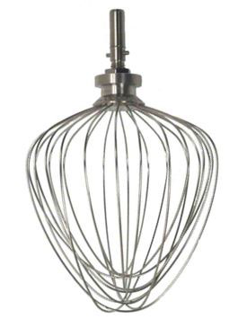](images/KAT71.000SS.png) |
| [KAT72.000SS](images/KAT72.000SS.png) [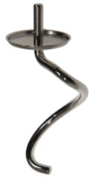](images/KAT72.000SS.png) | [KAT73.000CA](images/KAT73.000CA.png) [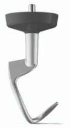](images/KAT73.000CA.png) | [AT502](images/AT502.png) [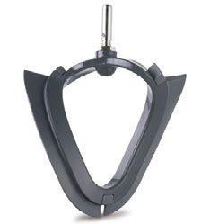](images/AT502.png) |
| [AT512](images/AT512.png) [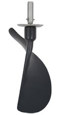](images/AT512.png) | [KAT90.000ME](images/KAT90.000ME.png) [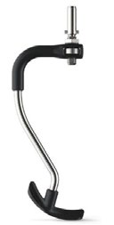](images/KAT90.000ME.png) | [KAT20.000GY](images/KAT20.000GY.png) [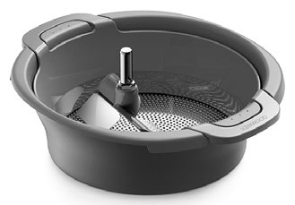](images/KAT20.000GY.png) |
| [KAX71.000WH](images/KAX71.000WH.png) [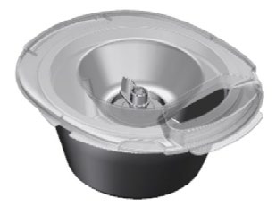](images/KAX71.000WH.png) | [KAB90.000SS](images/KAB90.000SS.png) [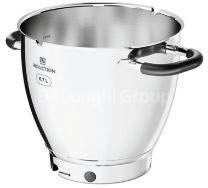](images/KAB90.000SS.png) | [KAT91.000CL](images/KAT91.000CL.png)  |
| [KAT92.000BK](images/KAT92.000BK.png)  |  |  |

## 7. Итоги: как не купить два одинаковых решения

| Задача | С чего начать | Что пока не докупать |
| --- | --- | --- |
| Овощи для обычной готовки, включая кубики | **KAH65.000PL с Express Dice** | AT340, KAX643ME и KAX400PL, пока не появились объёмы/задачи, которых комбайну не хватает |
| Массовая тёрка и шинковка, заготовки | **AT340** вместо комбайна, если нож и кубики не нужны | KAX643ME для той же задачи |
| Фарш и колбасы | **KAX950ME** | Вторую мясорубку; ножевой измельчитель не считать полным аналогом |
| Пельмени, вареники, лазанья | **Одна раскатка: KAX980ME или KAX99.A0ME** | Вторую раскатку; резки не нужны только ради пельменей |
| Длинная домашняя паста | Одна раскатка + **одна любимая резка**, либо **MAX980ME** | Сразу все четыре резки; отдельные дубли состава набора |
| Равиоли | Раскатка + ручная форма, затем KAX93 по необходимости | MAX94.A0ME, если его раскатка уже есть; два набора с одинаковым KAX980ME |
| Фигурная / полая паста | **KAX92.A0ME**, затем 1–2 матрицы | Все матрицы заранее; прессу раскатка не требуется |
| Ягодное/томатное пюре без семян и кожицы | **KAX644ME или KAT20.000GY** | Оба сразу, если решаете одну и ту же задачу протирания |
| Сок | **KAX720PL или AT641**; AT312 — если преимущественно цитрусы | Обе основные соковыжималки сразу |
| Смузи, суп-пюре, малое измельчение | Сначала уже имеющийся **Braun MQ9147X** | KAH359A.000GL и KAH740PL без потребности в их формате |
| Взбивание и замес | Штатные инструменты Kenwood | Повторные K-насадку, венчик, крюк, гибкую насадку и мешалку |
| Подключение | Современная насадка напрямую | KAT002ME без старой Bar-насадки; KAT001ME вообще |

Это рекомендации по выбору, основанные на функциях устройств, **а не требование приобрести полный каталог**.

## 8. Топы: популярность в РФ и порядок покупки

### Топ-10 по сортировке «Популярные» российского магазина Kenwood

Источник — [раздел «Насадки и аксессуары», сортировка «Популярные»][popular], проверенный **04.10.2026**, включая [вторую страницу][popular2]. Для этого списка оставлены совместимые дополнительные насадки и наборы; пропущены чехлы, кондитерские принадлежности и венчик, который уже есть в машине. Порядок оставшихся товаров сохранён.

**Это порядок выдачи одного магазина, а не рейтинг продаж по всей России.** Магазин не раскрывает числа продаж и алгоритм сортировки; выдача может изменяться. Оценки из другого региона сюда не перенесены.

| Место среди отобранных насадок | Модель | Что означает для вашего выбора |
| --- | --- | --- |
| **1** | KAH359A.000GL — блендер | Популярен в выдаче, но у вас сильно пересекается с Braun |
| **2** | KAX950ME — мясорубка | Даёт отдельную функцию фарша через решётку и колбас |
| **3** | AT340 — овощерезка | Практична для массовой тёрки и шинковки |
| **4** | KAX400PL — кубикорезка | Перед покупкой сравнить с кубиками нового KAH65 |
| **5** | KAX99.A0ME — раскатка XL | Для больших пластов; более узкий KAX980 тоже актуален |
| **6** | AT320A — мельничка | Для кофе/твёрдых специй ценнее, чем для задач, уже закрытых Braun |
| **7** | KAX720PL — шнековая соковыжималка | Имеет смысл при регулярном приготовлении соков |
| **8** | KAH65.000PL — комбайн | По полезности новых функций именно для вас может быть выше своего места в выдаче |
| **9** | KAX71.000WH — мороженица | Для регулярных замороженных десертов |
| **10** | MAX980ME — комплект пасты | Сравнить цену набора с раскаткой и нужными резками по отдельности |

### Практический рейтинг покупки для KCL95.004SI + вашего Braun

Ниже **мой приоритет по добавляемым функциям и отсутствию дублей**, а не статистика популярности. Если соответствующие блюда не готовите, пропускайте позицию; рейтинг не обязывает покупать все десять.

| Приоритет | Что купить | Когда это оправдано |
| --- | --- | --- |
| **1** | **KAX950ME** | Регулярно нужен фарш или домашние колбасы; если мясо не используете — начать со следующей позиции |
| **2** | **KAH65.000PL с Express Dice** | Нужны тёрки, ровная шинковка и кубики, которых нет в комплекте MQ9147X. Для объёмных заготовок вместо него рассмотреть AT340 |
| **3** | **Одна раскатка: KAX980ME / KAX99.A0ME** | Пельмени, вареники, лазанья, домашняя паста; ширину выбрать по своей готовке |
| **4** | **Одна паста-резка или MAX980ME** | Только если будете делать длинную пасту. Набор заменяет покупку позиций № 3 и № 4 по отдельности |
| **5** | **KAX71.000WH** | Любите домашнее мороженое и можете заранее замораживать ёмкость |
| **6** | **KAX644ME или KAT20.000GY** | Часто протираете ягоды и томаты без семян; выбрать один способ |
| **7** | **KAX720PL или AT641** | Регулярно пьёте свежий сок; выбрать шнековый или центробежный отжим |
| **8** | **Вторая KAB90.000SS** | Часто готовите несколько этапов/блюд подряд и мешает необходимость мыть единственную чашу |
| **9** | **AT512** | Часто делаете бисквиты, суфле и другие воздушные смеси; ручная лопатка перестала устраивать |
| **10** | **AT312** | Цитрусовый сок нужен часто; для редкого лимона ручной пресс проще |

**Сценарии, которые меняют рейтинг:** зерновая мука — KAX941PL; кофе и твёрдые специи — AT320A; полая и фигурная паста — KAX92.A0ME; овощные спирали — KAX700PL; равиоли большими партиями — KAX93.A0ME. Для этих задач специализированная насадка поднимается выше общего топа.

**Отложить при вашем наборе:** KAH359A.000GL и KAH740PL; KAX400PL после комбайна с кубиками; вторую систему тёрок; повторные штатные инструменты. **Минимальный разумный старт — одна-две насадки под реальные блюда**, например KAX950ME + KAH65.000PL, либо KAH65.000PL + одна раскатка для кухни без мясорубки.

## 9. Возможные конфликты и дублирование с Braun MultiQuick 9 MQ9147X

Здесь «конфликт» означает **покупку одинаковой функции**. Крепления Braun EasyClick Plus и Kenwood не взаимозаменяемы: насадки используются со своим прибором. Одновременное владение устройствами не мешает работе каждого.

### Что уже есть именно в MQ9147X

В стандартном российском комплекте: **погружная нога, венчик, насадка для пюре, измельчитель 350 мл, кувшин-измельчитель 1,25 л и мерный стакан 600 мл**. Производитель также показывает **специальный нож для льда** для кувшина. **350 мл, а не 500 мл**; дисков для тёрки, шинковки или кубиков в этом комплекте нет. [Карточка Braun РФ][braun-ru], [состав коробки у производителя][braun-world].

**Не считать маленький измельчитель кофемолкой:** инструкция запрещает обычным ножам измельчителей кофе в зёрнах, зерно и особо твёрдые специи. Лёд обрабатывают только предусмотренным специальным ножом в подходящем кувшине. Отдельной кофейно-пряной мельницы в MQ9147X нет. [Инструкция Braun, раздел Chopper accessory][braun-manual].

### Какие покупки пересекаются с Braun

| Насадка / функция Kenwood | Что уже умеет Braun | Степень дублирования | Когда Kenwood всё же полезен |
| --- | --- | --- | --- |
| **KAH359A.000GL** | Погружная нога для супов/соусов; кувшин 1,25 л для напитков и измельчения; специальный нож для льда | **Высокая** | Нужен стеклянный стационарный кувшин, соответствующий объём и привычный формат блендера |
| **KAH740PL** | Смузи и коктейли в кувшине/стакане | **Высокая** | Постоянно используете бутылку «смешал — взял с собой» |
| **AT320A** | Малые порции зелени, лука, орехов и других допустимых продуктов в 350 мл | **Частичная** | Нужны сухой помол кофе/специй или отдельные стеклянные баночки. Эти задачи обычным ножом Braun не закрываются |
| **Нож KAH65.000PL** | Измельчители 350 мл и 1,25 л | **Средняя по ножу** | **Тёрки, регулируемая шинковка, соломка и кубики** добавляют функции, отсутствующие в MQ9147X |
| **Венчик KAT71 / штатный венчик** | Белки, сливки, лёгкие смеси небольшими порциями | **Частичная по задаче** | Kenwood работает в большой чаше без удерживания мотора; отдельный второй венчик Kenwood не нужен |
| **Пюре через KAT20 или KAX644** | Насадка Braun для пюре и погружная нога | **Частичная** | Kenwood **отделяет кожицу/семена**; Braun разминает или измельчает их вместе с продуктом |
| **KAX950ME** | Нож может рубить небольшую порцию мяса в пределах инструкции | **Низкая** | Ровный фарш через решётку, подбор крупности, колбасы/кеббе |
| **KAX71.000WH** | Кувшин измельчает замороженные продукты для десертов | **Низкая** | Мороженица перемешивает смесь в охлаждённой ёмкости в процессе замораживания; это другой результат |
| **AT340 / KAX643 / KAX400** | Штатных дисков и кубикорезки у MQ9147X нет | **Практически нет** | Ровная тёрка/шинковка/кубики. Но внутри Kenwood сравнить с KAH65, чтобы не получить дубль |
| **Паста, спиралайзер, зерновая мельница, соковыжималки** | Соответствующих функций в комплекте MQ9147X нет | **Нет прямого аналога** | Покупать по частоте именно этих задач |

Сравнение — вывод по подтверждённым функциям и [комплекту MQ9147X][braun-world]. **Для вашей кухни сильнее всего расширяют возможности мясорубка, овощная обработка дисками/кубиками и раскатка теста; блендеры, малое измельчение и повторные инструменты стоит покупать только ради конкретного удобства.**

[machine]: https://kenwood.ru/product/kuhonnaya-mashina-cooking-chef-xl-kcl95-004si/
[manual95]: https://kenwood.ru/upload/iblock/09b/ec5k3dqwiri5spnux8mo2zl9ihmk59uy/5f8567cc_33db_11eb_b85c_ba33aac27f4d.pdf
[manual65]: https://kenwood.ru/upload/iblock/f16/b417o8zjx6vyublfozuqzdi10tumub1t/a0be8f68acd04cb7b07606ff87b88ae3.pdf
[manual93]: https://dls.delonghigroup.com/files/docs/5/141754-Iss-1-KAX93-A0-ME-multilingual.pdf
[manual71]: https://kenwood.ru/upload/iblock/83c/3pg80i620vlxgvj6b2gcmztlf71kliur/KAX71.00.pdf
[manual20]: https://kenwood.ru/upload/iblock/24f/eh1l81gn8ohqud9y34bnrzc60ueu5e5q/KAT20.000GY.pdf
[compat-web]: https://www.kenwoodworld.com/en-gb/e/kenwood-stand-mixer-attachment-compatibility-guide
[compat-new]: https://dls.delonghigroup.com/files/docs/72/KM-Attachments-Compatibility-Chart-V8-2.pdf
[compat-old]: https://dls.delonghigroup.com/files/docs/4/KM-attachments-compatibility-v4.pdf
[medium]: https://www.kenwoodworld.com/it-it/faqs/Which-attachments-will-fit-my-Chef/a/34002
[kax941]: https://www.kenwoodworld.com/en-ae/p/food-preparation-attachments-grain-mill-attachment-kax941pl/KAX941PL.html?pid=AW20010008
[max94]: https://www.kenwoodworld.com/en/p/chef-attachments-ravioli-maker-lasagne-roller-max94.a0me/MAX94.A0ME.html?pid=AW20011041
[kat70ca]: https://www.kenwoodworld.com/de-at/p/chef-attachments-aluminiumbeschichteter-k-haken-xl-kat70.000ca/KAT70.000CA.html?pid=AW20011062
[kat73]: https://www.kenwoodworld.com/lt-lt/p/chef-attachments-aluminium-xl-dough-hook-kat73.000ca/KAT73.000CA.html?pid=AW20011059
[kat91]: https://www.kenwoodworld.com/it-it/c/accessori/elementi-essenziali-per-la-cucina
[kat92]: https://www.kenwoodworld.com/de-de/c/zubehorteile-chef/kuchenutensilien
[go]: https://www.kenwoodworld.com/en-gb/p/kenwood-go-go-collection-glass-mini-choppermill-kag30.000gy/KAG30.000GY.html?pid=AW20010054
[cam01]: https://www.kenwoodworld.com/de-de/p/kuchenmaschine-mit-kochfunktionall-in-one-kocher-cookeasy-dampfgarer-aus-edelstahl-cam01.a0ss/CAM01.A0SS.html?pid=AW20611002
[dies]: https://www.kenwoodworld.com/en-gb/c/all-attachments/pasta-dies
[dies-catalog]: https://www.kenwoodworld.com/medias/Kenwood-DE-Katalog-2025-72dpi.pdf?context=bWFzdGVyfHJvb3R8NDc5OTA0OXxhcHBsaWNhdGlvbi9wZGZ8YUdSaEwyaGpPUzgyT0RBd01UYzNOakUzTXpBNE5pOUxaVzUzYjI5a1gwUkZYMHRoZEdGc2IyZGZNakF5TlY4M01tUndhUzV3WkdZfDUyOWZkODA2ZTRmMDk4NWMzMTJhZDdiNDZmZWE2OWNlZTBlMGJjNGQ3MjAzYTUwNGFkZDA5Yjk5MWUzYzNlNmQ
[popular]: https://kenwood.ru/category/nasadki-i-aksessuary/?SORT=popular
[popular2]: https://kenwood.ru/category/nasadki-i-aksessuary/?SORT=popular&PAGEN_1=2
[braun-ru]: https://braunhousehold.ru/product/blender-braun-mq9147x-/
[braun-world]: https://www.braunhousehold.com/en/p/multiquick-9-multiquick-9-hand-blender-mq-9147x/HB901-MQ9147X.html
[braun-manual]: https://library.delonghigroup.com/assetbank-delonghi/action/directLinkImage?assetId=197352&download=true
[kah65]: https://kenwood.ru/product/nasadka-kukhonnyy-kombayn-kenwood-kah65-000pl/
[at320]: https://kenwood.ru/product/nasadka-universalnyj-multiizmelchitel/
[blender]: https://kenwood.ru/product/nasadka-termostoykiy-steklyannyy-blender-kenwood-kah359a-000gl/
[kah740]: https://kenwood.ru/product/nasadka-smuzi-kah740pl/
[at340]: https://kenwood.ru/product/vysokoskorostnaya-nasadka-ovoshcherezka-at340/
[at312]: https://kenwood.ru/product/nasadka-citrus-press-at312/
[at641]: https://kenwood.ru/product/nasadka-centrifuzhnaya-dlya-sokovyzhimalki-at641/
[kax950]: https://kenwood.ru/product/nasadka-myasorubka-kax950me/
[kax400]: https://kenwood.ru/product/nasadka-dlya-narezki-kubikami-kax400pl/
[kax643]: https://kenwood.ru/product/nasadka-terka-lomterezka-kax643me/
[kax644]: https://kenwood.ru/product/nasadka-press-dlya-yagod-i-fruktov-kax644me/
[kax700]: https://kenwood.ru/product/nasadka-spiralajzer-kax700pl/
[kax720]: https://kenwood.ru/product/nasadka-shnekovaya-sokovyzhimalka-kax720pl/
[kax99]: https://kenwood.ru/product/nasadka-dlya-raskatki-testa-kax99aome-xl/
[kax980]: https://kenwood.ru/product/nasadka-dlya-raskatki-testa/
[kax981]: https://kenwood.ru/product/nasadka-dlya-prigotovleniya-fettuchchine-kax981me/
[kax982]: https://kenwood.ru/product/nasadka-dlya-prigotovleniya-talolini-kax982me/
[kax983]: https://kenwood.ru/product/nasadka-dlya-prigotovleniya-trenette-kax983me/
[kax984]: https://kenwood.ru/product/nasadka-dlya-spagetti-kenwood-chef-kmix-kax984me/
[kax92]: https://kenwood.ru/product/nasadka-dlya-pasty-kax92-a0me/
[kax93]: https://kenwood.ru/product/nasadka-ravioli/
[max980]: https://kenwood.ru/product/nabor-nasadok-dlya-pasty-max980me/
[kat70]: https://kenwood.ru/product/kenwood-nasadka-k-beater-xl-kat70-000ss/
[kat71]: https://kenwood.ru/product/880/
[kat72]: https://kenwood.ru/product/kenwood-spiralnyj-kryuk-dlya-testa-kat72-000ss/
[at502]: https://kenwood.ru/product/kenwood-nasadka-dlya-smeshivaniya-at502/
[at512]: https://kenwood.ru/product/nasadka-dlya-smeshivaniya-at512major/
[kat90]: https://kenwood.ru/product/kenwood-nasadka-dlya-pomeshivaniya-kat90-000me/
[kat20]: https://kenwood.ru/product/kenwood-nasadka-dlya-proseivaniya-i-protiraniya-kat20-000gy/
[kax71]: https://kenwood.ru/product/kenwood-morozhenica-kax71-000wh/
[kab90]: https://kenwood.ru/product/chasha-metallicheskaya-braun-kab90-000ss/
[die1]: https://kenwood.ru/product/disk-d-km-bigoli-awat910002/
[die2]: https://kenwood.ru/product/disk-d-km-kazareche-awat910003/
[die3]: https://kenwood.ru/product/nasadka-disk-dlya-makeroni-lichi-awat910004/
[die4]: https://kenwood.ru/product/disk-d-km-spakkatelli-awat910005/
[die5]: https://kenwood.ru/product/disk-d-km-spagetti-awat910006/
[die6]: https://kenwood.ru/product/disk-d-km-pappardelle-awat910007/
[die7]: https://kenwood.ru/product/disk-d-km-silatelle-awat910008/
[die8]: https://kenwood.ru/product/disk-d-km-linguini-awat910009/
[die9]: https://kenwood.ru/product/disk-d-km-fuzilli-awat910010/
[die10]: https://kenwood.ru/product/disk-d-km-konkiliette-awat910011/
[die11]: https://kenwood.ru/product/disk-d-km-bukatini-awat910012/
[die12]: https://kenwood.ru/product/nasadka-dlya-prigotovleniya-orekette-a910-12/
[die13]: https://kenwood.ru/product/disk-d-km-biskvity-awat910014/
